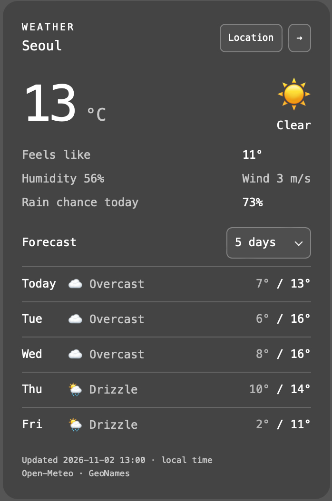
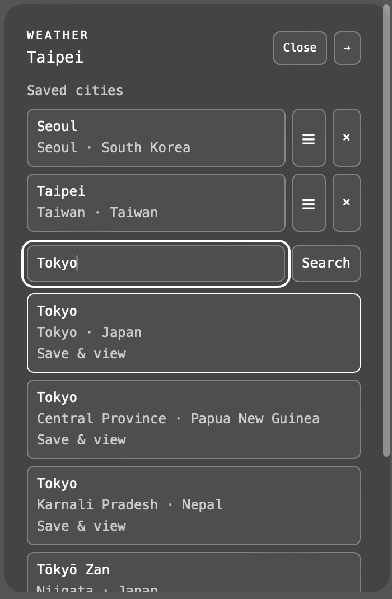
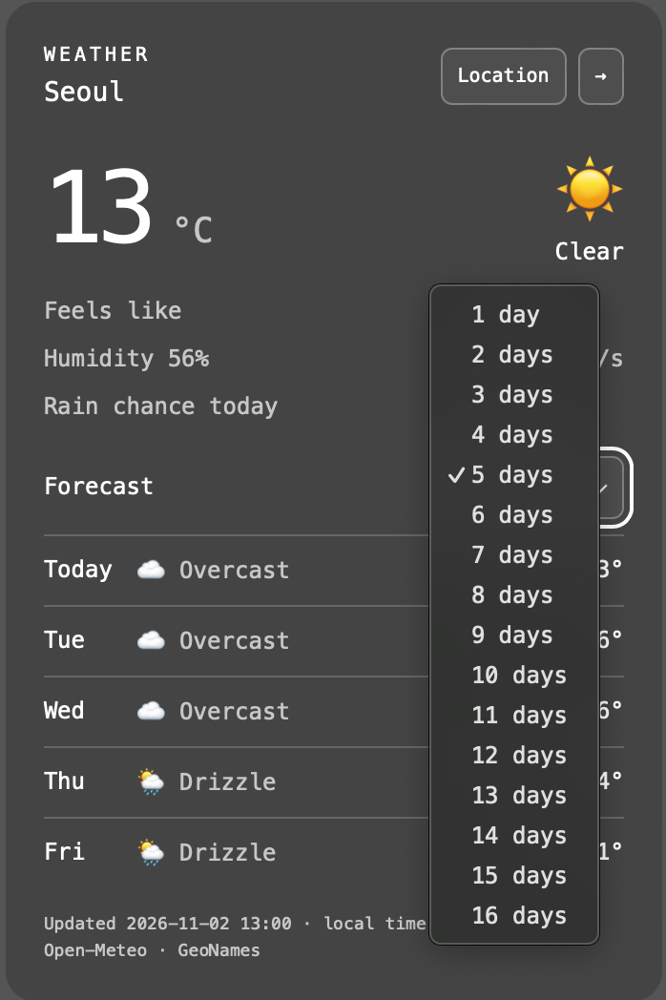
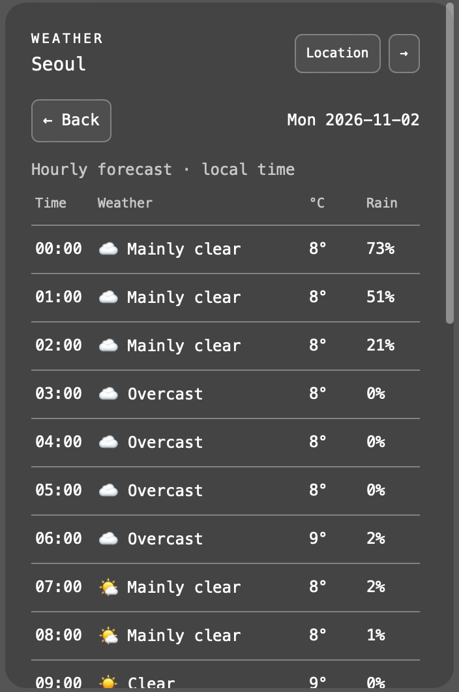

# ubersicht-weather-widget

[繁體中文](README.zh-TW.md) | [English](README.md)

macOS [Übersicht](https://tracesof.net/uebersicht/)용 날씨 위젯으로, 자유로운 외관 설정과 여러 도시의 일별·시간별 예보를 지원합니다.



API 키를 설정하지 않아도 날씨를 확인할 수 있습니다.

- 날씨 데이터는 [Open-Meteo](https://open-meteo.com/)에서 제공합니다.
- 지역 검색은 [GeoNames](https://www.geonames.org/) 데이터를 사용합니다. 일부 행정구역은 검색 결과에 나타나지 않을 수 있습니다.

## 설치

macOS, Übersicht, Node.js가 필요합니다. 설정 파일 동기화 기능은 현재 `/usr/local/bin/node`를 호출합니다. Node.js가 다른 경로에 설치되어 있다면 `index.jsx`의 실행 경로를 수정하세요.

1. 프로젝트를 다운로드하고 폴더 이름을 `ubersicht-weather-widget`으로 설정하세요.
2. 폴더 전체를 `~/Library/Application Support/Übersicht/widgets/`에 넣으세요.
3. Übersicht 메뉴에서 **Refresh All Widgets**를 선택한 뒤 아래 방법으로 도시를 추가하세요.

터미널에서 바로 설치할 수도 있습니다.

```sh
mkdir -p "$HOME/Library/Application Support/Übersicht/widgets"
git clone https://github.com/yozlog/ubersicht-weather-widget.git "$HOME/Library/Application Support/Übersicht/widgets/ubersicht-weather-widget"
```

설치 후 Übersicht 메뉴에서 **Refresh All Widgets**를 선택하세요.

## 사용 방법

먼저 Übersicht의 상호작용 기능을 활성화하세요.

- **Location**: 도시 관리. **→**: 도시 전환.
- **☰**를 길게 누른 채 드래그하면 도시 순서를 바꿀 수 있습니다.



- **Forecast**: 1~16일 예보를 선택합니다.



### 시간별 예보

일별 예보를 누르면 해당 날짜의 시간별 예보를 볼 수 있습니다.



## 데이터 갱신

- 선택한 도시의 현재 날씨, 일별 예보, 시간별 예보를 15분마다 자동 갱신합니다.
- 도시를 전환하면 해당 도시의 데이터를 즉시 가져옵니다.
- 갱신에 실패하면 현재 실행 중 마지막으로 받은 데이터를 유지하고 안내 메시지를 표시합니다.
- 시간은 도시의 현지 시간대를 기준으로 표시됩니다.

## 도시 및 예보 설정 동기화

설정의 기준은 `config.json`입니다. UI에서 도시 추가·삭제, 정렬, 현재 도시 전환, 예보 일수를 변경하면 파일에 저장됩니다. 파일을 직접 수정해도 위젯에 적용됩니다. 해당 항목만 변경하므로 너비와 높이 등 다른 설정은 유지됩니다.

관련 항목의 예시입니다. 기존 파일을 편집할 때는 다른 항목을 유지하세요.

```json
{
  "cities": [
    { "name": "Seoul", "latitude": 37.566, "longitude": 126.9784 },
    { "name": "Taipei", "latitude": 25.033, "longitude": 121.5654 }
  ],
  "location": { "name": "Seoul", "latitude": 37.566, "longitude": 126.9784 },
  "forecastDays": 7
}
```

`cities`의 배열 순서가 도시 전환 순서입니다. `location`은 현재 도시이며, `null`이면 목록의 첫 번째 도시를 사용합니다. `forecastDays`에는 1~16을 입력할 수 있습니다. 각 도시에는 이름, 위도, 경도가 필요합니다. 검색 결과의 행정구역과 국가 등 다른 항목도 유지할 수 있습니다. 모든 도시를 지우려면 `cities`를 `[]`, `location`을 `null`로 설정하세요.

올바른 JSON 형식을 유지하세요. 저장에 실패하면 위젯에 메시지가 표시되며, 저장되지 않은 변경 사항은 다시 로드할 때 사라질 수 있습니다. 편집기와 UI에서 같은 항목을 동시에 변경하면 마지막으로 저장한 값이 적용됩니다.

## 위치 설정

`config.json`에서 화면 위쪽과 왼쪽 가장자리로부터의 거리를 픽셀 단위로 설정하세요.

```json
{
  "top": 44,
  "left": 20
}
```

기본값은 `top: 44`, `left: 20`입니다. 생략하거나 `null` 또는 숫자가 아닌 값을 입력하면 기본값을 사용합니다.

## 너비 설정

같은 폴더의 `config.json`에서 픽셀 단위의 양수를 입력하세요.

```json
{
  "width": 288
}
```

기본 너비와 최소 너비는 모두 288px입니다. `null`, 생략된 값, 숫자가 아닌 값, 288보다 작은 값은 288px로 처리됩니다.

## 높이 설정

`config.json`의 `maxHeight`와 `minHeight`를 픽셀 단위로 설정하세요. 포함된 기본값은 다음과 같습니다.

```json
{
  "width": 288,
  "maxHeight": null,
  "minHeight": null
}
```

두 높이 설정의 기본값은 `null`입니다. 생략된 값, 숫자가 아닌 값, 0 이하의 값도 제한 없음으로 처리됩니다. 높이는 콘텐츠에 맞춰 조절됩니다. 예를 들어 이틀 예보만 표시하면 최대 높이를 채우지 않고 짧아집니다. 콘텐츠가 `maxHeight`를 넘을 때만 스크롤됩니다. `minHeight`를 설정하면 콘텐츠가 적어도 해당 높이를 유지합니다. 높이에는 안쪽 여백이 포함되며, 최소 높이가 최대 높이보다 크면 최대 높이를 우선합니다.

높이를 제한하려면 `maxHeight`에 원하는 픽셀 값을 설정하세요. Übersicht의 상호작용 기능을 활성화한 뒤 위젯 위에서 마우스 휠이나 트랙패드로 스크롤할 수 있습니다. 콘텐츠에 키보드 포커스를 두고 방향키를 사용할 수도 있습니다. 스크롤바는 마우스를 올렸을 때만 표시되며, 마우스가 벗어나면 숨겨집니다.

**Location** 화면과 날씨 화면은 같은 높이 제한과 스크롤 영역을 사용합니다. 저장된 도시나 검색 결과가 많으면 `maxHeight`를 넘는 부분을 스크롤할 수 있고, `minHeight`도 동일하게 적용됩니다. 도시 목록의 높이를 따로 설정할 필요가 없습니다. `maxHeight`가 `null`이면 두 화면 모두 높이를 제한하지 않습니다.

## 날씨 상태 표시

`config.json`에서 다음과 같이 설정하세요.

```json
{
  "weatherDisplay": "both"
}
```

사용 가능한 값:

- `"text"`: `Rain`처럼 영어 텍스트만 표시합니다.
- `"emoji"`: 🌧️처럼 이모지만 표시합니다. 마우스를 올리면 텍스트 설명이 나타나며, 스크린 리더로도 날씨 이름을 읽을 수 있습니다.
- `"both"`: `🌧️ Rain`처럼 이모지와 영어 텍스트를 함께 표시합니다(기본값).

현재 날씨, 일별 예보, 시간별 예보에 모두 적용됩니다. 생략하거나 `null` 또는 지원하지 않는 값을 입력하면 `"both"`를 사용합니다. 맑은 날씨는 현재·시간별 데이터를 기준으로 낮과 밤을 구분합니다. UI에서 도시나 예보 일수를 저장해도 이 설정은 유지됩니다.

## 색상 설정

`config.json`의 `colors`에서 라이트 모드(`light`)와 다크 모드(`dark`)의 색상을 각각 설정하세요. 시스템 화면 모드에 따라 자동으로 전환됩니다. 기본값은 다음과 같습니다.

```json
{
  "colors": {
    "light": {
      "background": "#ffffff",
      "foreground": "#000000",
      "backgroundOpacity": 0.25
    },
    "dark": {
      "background": "#000000",
      "foreground": "#ffffff",
      "backgroundOpacity": 0.2
    }
  }
}
```

- `background`: 배경색입니다. `#263238`처럼 `#RGB` 또는 `#RRGGBB` 형식을 사용하세요.
- `foreground`: 같은 형식의 텍스트 및 컨트롤 색상입니다. 보조 텍스트, 구분선, 버튼 테두리, 스크롤바에는 이 색상이 서로 다른 불투명도로 적용됩니다.
- `backgroundOpacity`: `0`(완전 투명)부터 `1`(완전 불투명)까지의 숫자입니다.

필요한 모드나 항목만 변경해도 됩니다. 생략되거나 `null` 또는 잘못된 형식인 항목은 각각 기본값을 사용합니다. 이모지는 원래 색상을 유지합니다. UI에서 도시나 예보 일수를 저장해도 색상 설정은 유지됩니다.

## 개발 및 테스트

`node check.cjs`를 실행하면 Übersicht에 포함된 Babel / React로 JSX와 데이터 상태를 검증합니다. 별도 패키지는 설치하지 않습니다.

## 라이선스

이 프로젝트는 [The Unlicense](LICENSE)를 사용합니다. 타사 의존성, 서비스, 데이터에는 각각의 라이선스와 약관이 적용됩니다.

## 개발 안내

이 프로젝트는 AI 코드 에이전트의 도움을 받아 개발 및 유지보수됩니다.
