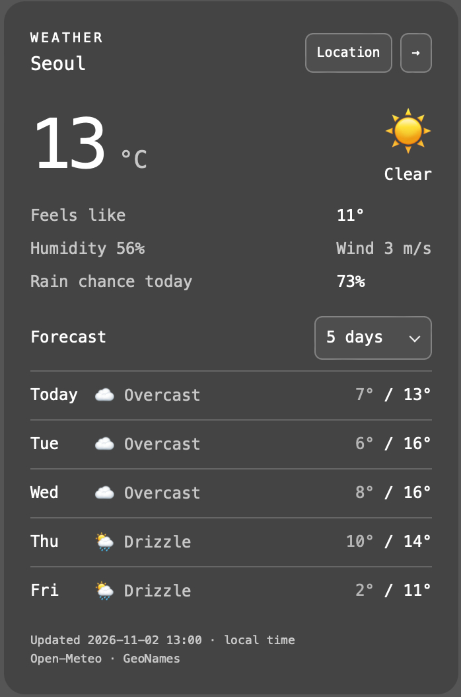
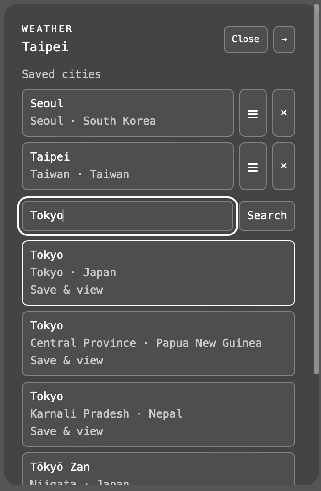
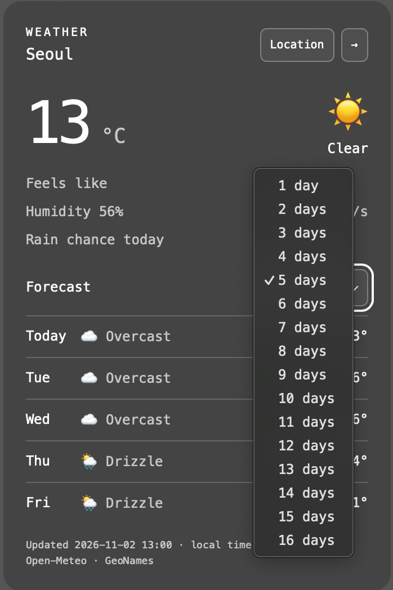
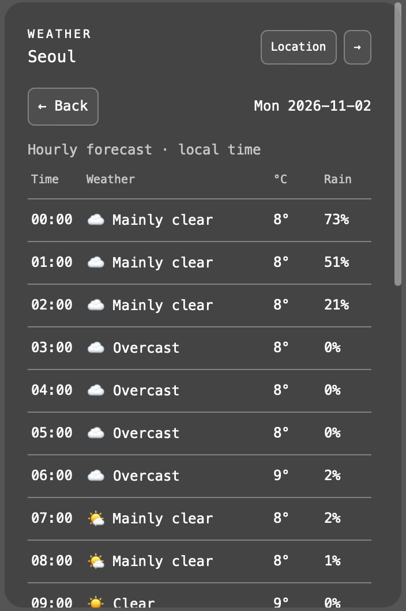

# ubersicht-weather-widget

[English](README.md) | [한국어](README.ko.md)

適用於 macOS [Übersicht](https://tracesof.net/uebersicht/) 的高度可自訂天氣 widget，支援多城市、每日與逐小時預報。



無需設定 API key，即可查詢天氣。

- 天氣資料由 [Open-Meteo](https://open-meteo.com/) 提供。
- 地區搜尋使用 [GeoNames](https://www.geonames.org/) 資料，部分行政區可能無法搜尋。

## 安裝

需要 macOS、Übersicht 與 Node.js。目前設定檔同步功能會呼叫 `/usr/local/bin/node`；若 Node.js 安裝在其他位置，請修改 `index.jsx` 中對應的執行路徑。

1. 下載專案，並將資料夾命名為 `ubersicht-weather-widget`。
2. 將整個資料夾放到 `~/Library/Application Support/Übersicht/widgets/`。
3. 在 Übersicht 選單選擇 **Refresh All Widgets**，接著依下方步驟設定城市。

也可在終端機直接安裝：

```sh
mkdir -p "$HOME/Library/Application Support/Übersicht/widgets"
git clone https://github.com/yozlog/ubersicht-weather-widget.git "$HOME/Library/Application Support/Übersicht/widgets/ubersicht-weather-widget"
```

完成後，在 Übersicht 選單選擇 **Refresh All Widgets**。

## 使用

請先開啟 Übersicht 的互動功能。

- **Location**：管理城市；**→**：切換城市。
- 長按 **☰** 並拖曳可調整城市順序。



- **Forecast**：選擇 1–16 日預報。



### 分時預報

點擊每日預報查看該日分時預報。



## 資料更新

- 每 15 分鐘自動更新目前城市的天氣、每日與逐小時預報。
- 切換城市時會立即取得該城市的資料。
- 更新失敗時，保留本次執行最後成功取得的資料並顯示提示。
- 資料時間依城市當地時區顯示。

## 城市與預報設定同步

`config.json` 是設定的主要來源。UI 新增／移除城市、排序、切換目前城市、調整預報天數都會寫回檔案；直接編輯檔案後，widget 也會套用新值。更新只修改對應欄位，保留寬高與其他設定。

相關欄位範例（編輯既有檔案時請保留其他欄位）：

```json
{
  "cities": [
    { "name": "Seoul", "latitude": 37.566, "longitude": 126.9784 },
    { "name": "Taipei", "latitude": 25.033, "longitude": 121.5654 }
  ],
  "location": { "name": "Seoul", "latitude": 37.566, "longitude": 126.9784 },
  "forecastDays": 7
}
```

`cities` 的排列就是切換順序，`location` 是目前顯示的城市（設為 `null` 時使用清單第一筆），`forecastDays` 可填 1–16。城市至少需要名稱、緯度與經度；也可保留搜尋結果的行政區、國家等欄位。要清空城市，將 `cities` 設為 `[]`、`location` 設為 `null`。

請保留合法 JSON。若儲存失敗，widget 會顯示提示，尚未儲存的變更可能在重新載入後遺失。若同時在編輯器與 UI 修改同一欄位，以最後儲存的內容為準。

## 位置設定

在 `config.json` 設定距離螢幕頂端與左側的像素值：

```json
{
  "top": 44,
  "left": 20
}
```

預設 `top: 44`、`left: 20`；省略、`null` 或非數字時使用預設值。

## 寬度設定

編輯同資料夾的 `config.json`，寬度單位為 px，填寫正數即可：

```json
{
  "width": 288
}
```

預設寬度與最小寬度皆為 288px。`width` 設為 `null`、省略此欄位（`{}`）、填入非數字或小於 288 的數值時，使用 288px。

## 高度設定

在 `config.json` 設定 `maxHeight`（最大高度）與 `minHeight`（最小高度），單位同樣為 px。預設值：

```json
{
  "width": 288,
  "maxHeight": null,
  "minHeight": null
}
```

兩個高度設定皆預設 `null`；省略、非數字或非正數也視為未限制。高度跟隨內容自然調整，例如只顯示兩日預報時會縮短，不會撐滿最大高度。超過 `maxHeight` 才可捲動；設定 `minHeight` 後，內容不足時會保留指定的最小高度。高度包含內距；若最小高度大於最大高度，以最大高度為準。

若要限制高度，可將 `maxHeight` 設為需要的像素值。請先啟用 Übersicht 互動功能，將游標移入 widget 後使用滾輪／觸控板捲動，也可聚焦內容後使用方向鍵。捲動條僅在滑鼠移入時顯示，移開後隱藏。

Location 頁面與天氣頁面共用同一個高度限制及捲動容器：已儲存城市或搜尋結果過多時，一樣在超過 `maxHeight` 後捲動，並遵守 `minHeight`。不需要另外設定城市清單高度。`maxHeight` 為 `null` 時，兩個頁面都不限制高度。

## 天氣狀況顯示

在 `config.json` 設定：

```json
{
  "weatherDisplay": "both"
}
```

可選值：

- `"text"`：純英文文字，例如 `Rain`。
- `"emoji"`：純 emoji，例如 🌧️；移入時仍可查看文字提示，螢幕閱讀器也能讀取天氣名稱。
- `"both"`：emoji 加英文文字，例如 `🌧️ Rain`（預設）。

設定套用於目前天氣、每日與逐小時預報；省略、`null` 或不支援的值會使用 `"both"`。晴朗天氣會依目前／分時資料區分白天與夜間。UI 儲存城市與天數時會保留此設定。

## 配色設定

在 `config.json` 的 `colors` 分別設定淺色（`light`）與深色（`dark`）模式，隨系統外觀自動切換。預設值如下：

```json
{
  "colors": {
    "light": {
      "background": "#ffffff",
      "foreground": "#000000",
      "backgroundOpacity": 0.25
    },
    "dark": {
      "background": "#000000",
      "foreground": "#ffffff",
      "backgroundOpacity": 0.2
    }
  }
}
```

- `background`：背景色，使用 `#RGB` 或 `#RRGGBB` 格式，例如 `#263238`。
- `foreground`：文字及控制項顏色，格式同上。次要文字、分隔線、按鈕邊框與捲動條會使用此顏色的不同透明度。
- `backgroundOpacity`：背景透明度，數字範圍為 `0`（完全透明）至 `1`（完全不透明）。

可只修改需要的模式或欄位；省略、`null` 或格式無效的欄位會個別使用預設值。Emoji 保留原本的彩色外觀。UI 儲存城市與預報天數時會保留配色設定。

## 開發與測試

執行 `node check.cjs`，使用 Übersicht 隨附 Babel / React 驗證 JSX 與資料狀態；不安裝套件。

## 授權

本專案採用 [The Unlicense](LICENSE)。第三方相依套件、服務與資料各自適用其授權及條款。

## 開發聲明

本專案由 AI code agent 協助開發及維護。
